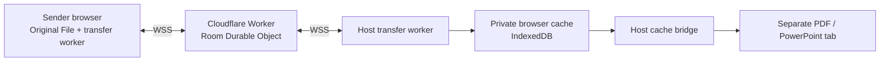

# WarpView

**From your phone, onto the big screen.**

Share files from a phone or laptop to a receiving screen, then present them from the browser. Create a room, scan its QR code or enter its six-digit code, and share without accounts or cloud-drive links.

[**Open WarpView**](https://warpview.net/) · [Instructions](https://warpview.net/#instructions) · [How it works](https://warpview.net/#how-it-works) · [Architecture explained](https://warpview.net/architecture) · [Report an issue](https://github.com/Punit-Dethe/flashview/issues)

Files are received into **private browser cache**. They do not appear in the computer's Downloads folder unless someone explicitly chooses Download. The relay forwards bytes; it does not keep a permanent cloud copy of the original.

## Share in three steps

1. **Create a room on the receiving screen.** Choose whether new participants need approval before creating it.
2. **Join from another device.** Scan the QR or enter the code. QR invitations offer an optional name or Skip.
3. **Choose your files.** They transfer automatically. Keep the sender's page open until Done; then present or download the browser-cached copy on the receiving screen.

## What you can do

- **Share across networks:** send files through an authenticated WebSocket relay without signing in.
- **Receive automatically:** a dedicated transfer worker owns the connection, range requests and browser-cache writes, separately from the interface.
- **Present PDFs and PowerPoint:** open a separate presentation tab with navigation, zoom, fullscreen and Close controls. Touch swipes move between pages or slides.
- **Identify who shared each file:** matching colored initials appear in the compact Shared by list, on file cards and on the sender's New button. The list represents file owners, not live connection counts.
- **Recover interrupted transfers:** retain committed chunks and resume missing ranges when the original sender remains available.
- **Manage the room:** approve pending participants, delete individual listings, or end the room and clear its browser cache.

| File type | Current behavior |
| --- | --- |
| PDF | Local PDF.js presentation; available cached ranges can render before the whole file arrives |
| PPTX / PPSX | Local slide presentation after complete receipt; saved thumbnail first, bounded rendering fallback |
| Other files, including legacy `.ppt` | Transfer and explicit Download; no built-in preview |

## How it is built



Node and Cloudflare adapters share the room and file state machines. The deployed app uses Cloudflare Workers and Durable Objects for routing and metadata; originals are cached in IndexedDB on the receiver. Presenter tabs read through the host's local cache bridge and do not open another room WebSocket.

**R2, OPFS and WebRTC/TURN are not part of the current production path.** R2 was deferred after the live comparison; OPFS remains an isolated storage experiment. Completion checks persisted chunk coverage, and range reads/exports validate lengths. There is no application-level source-to-receiver content hash. See the [technical architecture](./docs/architecture.md) for the exact boundaries and remaining limitations.

## Current limits

| Limit | Allowance |
| --- | --- |
| One file | 200 MiB |
| Files offered by one sender | 10 per room |
| Concurrent senders | 30 |
| Retained file records | 300 per room |
| Declared original file sizes | 4 GiB total per room |
| Retained join identities | 120 per room |

Stopped and deleted records still count toward admission budgets until the room ends. These are application limits, not a guarantee of available browser disk space. Rooms have a two-hour idle lifetime renewed by authorized host activity and restricted dashboard/presenter leases.

## Try it locally

Requires **Node.js 22+** and npm.

```bash
git clone https://github.com/Punit-Dethe/flashview.git
cd flashview
npm install
npm run dev
```

Open [http://localhost:5173](http://localhost:5173), create a room, then join it in a second browser window. To join from a physical phone, use an HTTPS deployment or tunnel: a `localhost` QR link cannot reach a different device.

## Documentation

All current engineering documentation lives under **[`docs/`](./docs/README.md)**.

| Guide | What it covers |
| --- | --- |
| [Architecture](./docs/architecture.md) | Components, browser/relay responsibilities, data flow, presentation and caching |
| [Transfer protocol](./docs/transfer-protocol.md) | WebSocket authentication, control messages, binary packets, progress and limits |
| [Development & testing](./docs/development.md) | Setup, scripts, codebase navigation, CI, reproducible tests and profiling |
| [Deployment](./docs/deployment.md) | Self-hosted Node and Cloudflare Workers / Durable Objects |
| [Security & recovery](./docs/security-and-reliability.md) | Threat boundaries, browser storage, failure handling and operational checks |
| [Reliability audit tracker](./docs/reliability-audit.md) | What is fixed, partly fixed and still pending, with PR evidence |
| [R2 comparison](./docs/r2-benchmark-results.md) | Historical measurements and why the production relay was retained |

## Important limitations

A sender's browser must stay available until the host has **fully cached** the file. Reloading or closing that page loses its selected File handles; reconnecting cannot restore those handles. Mobile operating systems can suspend tabs and workers.

HTTPS/WSS encrypts the connection to the relay, but WarpView is **not end-to-end encrypted**: the relay can access bytes in transit. Browser data can be evicted or cleared, and there is no permanent cloud backup. Keep original files on the source device. Preview speed, transfer speed and renderer memory use depend on the file, hardware and network; networks that block WSS have no HTTP-only file-transfer fallback.

## License

A project license has **not** been selected yet. Public source availability does not grant an open-source reuse license; dependencies retain their own licenses.
