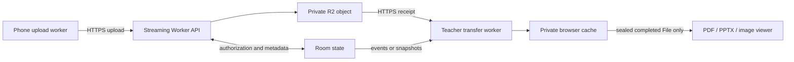

# FlashView implementation plan — independent transfer and viewing

**Revision 2 · 19 October 2026 · Implementation started; production R2 migration pending.** This replaces the earlier architecture proposal, including its viewer-driven priorities, progressive previews, and default segmented-object design. It incorporates the second source review and the user's clarified workflow. Baseline: local `main` reference `0a571289236a77b1e373ae10148fb594ca8831ef`.

## 1. Product contract

**Transfer as quickly and reliably as possible into the teacher's private browser cache. Present completed cached files through a separate subsystem.**

- Files are received into origin-private browser storage, preferably OPFS. They do **not** automatically appear in Downloads, prompt for a folder, or get saved as ordinary user-visible computer files. OPFS can use disk internally; it is still browser-managed storage.
- All admitted files transfer automatically. Opening a document, changing slides, closing a viewer, or selecting a different document cannot change transfer order, concurrency, retry policy, or network requests.
- PDF and PPTX/PPSX viewing starts only after the complete file is verified and cached. Add image viewing through the same interface later. No partial-page or phone-generated preview system is required.
- A student can close the page after the server confirms durable cloud receipt. The teacher may still be caching it. Show these as distinct milestones.
- Explicit **Download a copy** may remain as a separate user action. It is not part of automatic receipt, and its timing is not the transfer-performance metric.
- Correct bytes, recoverable failures, and speed take precedence over decorative previews. A rewrite is acceptable. Temporary R2 storage is accepted; preserving the old no-cloud architecture is not a requirement.

**Independence means no architectural feedback from viewing into transfer.** CPU, memory, and disk remain shared physical resources. We will bound rendering work and measure contention instead of promising that two workloads on one laptop can never affect each other.

**R2 acceptance clarification:** comparable classroom speed and improved connectivity/recovery
are both objectives. A modest measured speed tradeoff is acceptable when it improves
reliability; a large regression triggers reconsideration. Report absolute latency,
relative difference, failure rate, and recovery behavior together. Do not require
R2 to win every stopwatch comparison or accept a major regression solely for storage.

## 2. Decisions and boundaries

| Area | Recommended decision |
|---|---|
| Remote file storage | One immutable completed R2 Standard object per file; small PUTs and native multipart for larger files. Validate the speed decision in Phase 0 before committing to it. |
| Original-byte transport | Authenticated HTTPS streaming through stateless Worker endpoints. Durable Objects carry authorization and metadata only. No original file bodies through the room WebSocket or DO. |
| Transfer engine | Worker-owned services for phone upload and teacher cache reception. One bounded scheduling policy, fair across senders, with no viewer input. |
| Local bytes | OPFS; IndexedDB for small state, durable checkpoints, hashes, and completion records. No 64 KiB database transaction for every network chunk. |
| Viewer input | A sealed local `File`/`Blob` plus metadata. No upload, cache-repair, scheduler, or cloud-read capability. |
| Room state | Shared deterministic domain engine and runtime-validated versioned contracts, with thin Node and Cloudflare adapters. |
| Notifications | WSS for prompt updates; HTTPS snapshots/commands support the entire workflow when WSS is blocked. |
| Rendering | Lazy-loaded PDF/PPTX adapters isolated from room secrets; future images use the same completed-file contract. |

There is deliberately no arrow from the viewer back to the transfer engine.

### The storage-format decision must pass a speed gate

Whole-object R2 storage removes segment manifests, original-byte assembly, partial availability, and early-view coordination. However, the teacher normally cannot read a native multipart object until completion. Its approximate cold receipt time is `phone upload + object commit + teacher cache receipt + local verification`, rather than the overlap available in today's relay. Cloud storage is not automatically faster. [R2 upload behavior](https://developers.cloudflare.com/r2/objects/upload-objects/)

Phase 0 must compare this path against the current relay. If it causes a repeatable material regression or misses the reproduced campus target, test **transfer-only pipelining** with immutable segments. That alternative still caches everything fairly and publishes only completed local files; no first/tail PDF prioritization or progressive rendering returns. Choose one storage representation for new rooms and record the measured reason before Phase 2. Do not ship both as permanent parallel systems.

Start experiments with single PUT at or below 8 MiB and multipart above it, 8 MiB parts, and two in-flight parts per phone across all its files. Compare 16 MiB parts and bounded concurrency changes. These are experiment settings, not claims of optimal throughput. Native multipart non-final parts must be at least 5 MiB. [R2 upload constraints](https://developers.cloudflare.com/r2/objects/upload-objects/)

Use a same-origin streaming gateway initially: it gives consistent authorization, bounded actual request bodies, and one browser-facing hostname for college networks. Direct presigned R2 access is a separate optimization only if measurements justify it and replay, expiry, size enforcement, CORS, and network reachability are solved. Such URLs are reusable until expiry, not one-use grants. [Presigned URL behavior](https://developers.cloudflare.com/r2/api/s3/presigned-urls/)

## 3. What the deeper pass found

These are code-inspection findings; fault reproduction and fixes belong to the phases below. No tests were executed during this planning pass.

| Finding | Source evidence | Implementation response |
|---|---|---|
| **The existing viewer is already passive.** | `presentation.ts:123,141`; `pdf/roomCache.ts:672` explicitly prohibit viewer-driven fetching or priority changes. | Preserve that invariant. The earlier proposal's viewer priorities were a design mistake, not a required fix to current behavior. |
| **The speed benchmark does not measure all files completing.** | `tests/benchmark.baseline.ts:156` waits for the first 100% cache ring but reports `timeToCacheAllMs`; it first waits for presentation rendering. Configuration also caps runs at 45 MiB and 15 senders. | Fix the measurement before using it to choose an architecture. Track each file independently and the actual last completion, without waiting on a viewer. |
| **Stopped files can become approved again.** | Node `index.ts:313` and Cloudflare `index.ts:438` encode revocation as `offline`; resume paths at Node `:130` and Cloudflare `:197` restore offline files. | Terminal `revoked`/`cancelled` state separate from presence. Reconnection must not resurrect it. |
| **Cloudflare cancellation differs from Node.** | Node revoke removes outstanding ranges; Cloudflare revoke does not. The binary forwarder can still service an existing request. | Shared cancellation transition and attempt generations. Reject late results and release occupied slots promptly. |
| **Current completion checks structure, not content.** | `roomCache.ts:427,561,616` and completed-file readers validate indexes, offsets, lengths, and record structure, not cryptographic digests. | End-to-end integrity metadata and verification before `cached-ready`; inject same-length bit flips into tests. Existing successful-flow hash tests do not cover this failure. |
| **Optional phone previews consume resources during transfer.** | `App.tsx:753–767`; `pdf/firstPagePreview.ts` invokes PDF parsing, canvas encoding, and some full-buffer paths. | Remove phone preview generation and preview relay messages. Optional host thumbnails run only after cache completion and outside active transfer work. |
| **Cloudflare room liveness depends on a visible dashboard.** | `socket.ts:59–78` and `App.tsx:420–449` suppress hidden-page heartbeats/sync. Cloudflare renews on host traffic. Node additionally renews on protocol pongs at `server/index.ts:419`, so the implementations differ. | Explicit renewable classroom lease, independent of dashboard visibility. An active presenter may send a limited lease renewal, but has no byte-transfer privileges. Test the Cloudflare case specifically. |
| **Presentation has an unrelated two-hour timer.** | `presentation.ts:109` closes its bridge regardless of renewed room lifetime. | Remove that timer and the dependency on a live dashboard bridge for completed local files. |
| **End-room is not acknowledged before the host exits.** | `App.tsx:823–839` clears cache and drops credentials after an unchecked `socket.send`; `socket.ts:249` can return false. | Persist closure intent, confirm server closure, and track server cleanup and local cleanup independently. |
| **Per-file pause does not own all cancellation handles.** | `roomCache.ts:559,616` discards `requestRange` cancellation functions; `pause():776` removes jobs but not those requests. | The new engine owns an AbortController and generation for every operation. The enclosing app does close the socket on room exit; do not mislabel every exit as a leaked request. |

Other first-pass findings remain in scope: duplicate backend rules, Cloudflare abuse-control gaps, unbounded historical sessions/manifests, eager PDF imports on the sender entry path, renderer memory exposure, and a missing dependency lockfile. The Node UUID versus Cloudflare room-code distinction is **not** a demonstrated current cache-key bug: the inspected client consistently uses the code. New storage must nevertheless use an immutable room generation, never the reusable code.

## 4. Core contracts to implement

### Independent states and truthful progress

| State | Authority | Meaning |
|---|---|---|
| `offered / admitted` | Room engine | Metadata accepted and resources reserved; original bytes may not exist remotely yet. |
| `uploading / committing` | Upload service | Bytes or finalization are in progress; the phone must retain its source. |
| `uploaded` | Server | Expected parts/object length and provider receipts verified; an immutable cloud object is committed. Phone may close. |
| `receiving / verifying` | Teacher transfer worker | Original bytes are being cached or checked locally. |
| `cached-ready` | Local file store | Correct complete bytes are persisted, writer closed, completion record committed, and a local file is available. |
| `viewing / render-error` | Viewer | Local rendering only; cannot change the previous states. |
| `cancelled / revoked / expired` | Appropriate command/lifecycle owner | Explicit terminal outcome for that attempt, not a synonym for a temporarily disconnected phone. |

Identify every operation by `roomGeneration`, `fileId`, `uploadGeneration`, and command/request ID. Include expected length, immutable content version, cryptographic digest metadata, and access deadline. Distinguish protocol versions; use monotonic room revisions and idempotent receipts. Recover missed events from snapshots. Persist authoritative outcomes before broadcasting them.

Keep three concrete interfaces small:

- `RoomService`: validated commands, snapshots, leases, admission, revocation, and closure.
- `TransferService`: upload and automatic cache receipt, retries, cancellation, recovery, and progress. Its inputs never include selected document, page, renderer state, or viewport visibility.
- `CompletedFileStore` / `ViewerAdapter`: acquire a sealed local file, open it, navigate, close it. No reference to `RoomSocket.requestRange` or a network byte source.

A viewer encountering a missing local file shows unavailable. Cache reconciliation and any repair belong to the transfer service's normal admission-order/fair queue, not a high-priority viewer request. Explicit retry can be offered in the transfer UI. Cached files remain immutable; repair writes a new generation rather than modifying a file already handed to a viewer.

## 5. Phased implementation

Each phase ends with concrete acceptance evidence. Split phases into reviewable changes; retain old-room compatibility during migration, rather than combining all work into an untestable rewrite.

### Phase 0 — Correct the baseline and settle the transport choice

**Touch:** `tests/benchmark.baseline.ts`, `src/client/perf.ts`, new transfer-only benchmark fixtures/reports; a small isolated real-R2 prototype.

1. Fix the first-completion/all-completion error and record completion timestamps when events occur, not after awaiting a render. Add independent upload, cache-receipt, verification, and rendering measurements.
2. Test actual PDFs/PPTX plus incompressible binary fixtures at 1, 5, 20, 50, and 200 MiB; 1, 5, 15, and 30 senders. Separate single-file latency, whole-room completion, fairness, retry bytes, and sustained throughput.
3. Reproduce the user's observed 7–10 seconds for typical sub-50 MB presentations on the same campus conditions, recording exact bytes and whether that observation ended at cloud receipt or verified browser cache. Treat it as a target/reference observation until reproduced, not a universal guarantee.
4. Compare the existing relay and completed-object R2, with the same verification requirements. Test a transfer-only segment pipeline only if the whole-object path is materially slower. Compare gateway versus direct upload only when gateway latency is a measured bottleneck.
5. Run with no viewer and with repeated navigation in a different already-cached document. Fix queue inputs across both runs; record physical CPU/disk contention separately from any scheduling changes.
6. Check cold starts and R2 placement from the actual campus. Bucket location is not automatically the same as every Cloudflare edge; location hints are best effort. [R2 location](https://developers.cloudflare.com/r2/reference/data-location/)

**Exit:** a checked-in baseline and short decision record selecting storage layout, initial part size, concurrency caps, and measurable latency/memory/cost limits. Do not proceed with a storage choice that merely makes phone upload look fast while teacher caching regresses. No production infrastructure changes are needed to write this plan; implementation benchmarking will require an isolated test bucket.

### Phase 1 — Build shared contracts and fix lifecycle correctness

**Touch:** new `src/domain/` and `src/shared/contracts/`; both server entry points, `src/shared/protocol.ts`, `roomLifetime.ts`, and room/client state handling.

1. Extract shared admission, ownership, state transitions, terminal cancellation, idempotency, and revision handling. Persist indexed room/file/upload/session records instead of whole-array rewrites.
2. Separate the short join code from immutable room identity. Exchange QR/code entry for scoped participant credentials; retain approval and accountless joining.
3. Implement acknowledged room end and file cancellation. Retain pending command outcomes across refresh; never reconnect a revoked generation into an approved state.
4. Bound room bytes, file count, historic sessions, unauthenticated sockets, join attempts, and creation rate. Handle campus NAT fairly with combined IP/session/room policy.
5. Define a visible, renewable room lease and a configurable absolute retention ceiling. Allow a restricted teacher/presenter lease-renewal command without giving the renderer host or transfer authority. Hidden dashboard behavior must match across backends.
6. Add a lockfile and reproducible CI installation; define protocol negotiation and new-room feature selection before changing storage.

**Exit:** shared contract tests pass for Node and Cloudflare adapters, including duplicate commands, stale snapshots, stop/reconnect, hidden dashboard, takeover, and lost end acknowledgment. Keep original historical audit IDs intact; new findings get new IDs.

### Phase 2 — Implement durable cloud receipt, authorization, and cleanup

**Touch:** `src/cloudflare/index.ts`, `wrangler.jsonc`, new object-store/upload/cleanup adapters; Node adapter using the same domain contracts.

1. Implement reserve → upload → finalize → commit for the representation selected in Phase 0. With the recommended whole-object path, use bounded small PUT and multipart requests; persist upload attempt and completion intent before external operations.
2. Enforce actual stream length, owner, attempt, permitted part numbers, declared file size, and byte/operation reservations. Never load a full large file into Worker memory or hold a DO event open for the body transfer.
3. Use server-observed storage receipts, exact expected part sets/lengths, and a committed immutable object key. Reconcile successful finalization followed by a lost HTTP response or failed metadata commit. Never treat a client-provided ETag list alone as proof.
4. Pin expected per-part identity/checksums before retries. A lease timeout does not stop an old physical request. Resolve unknown outcomes; permit only identical validated content for a retried part, or abandon that generation and start a new upload ID/key. Reject late commits after cancellation.
5. Define integrity honestly. A multipart ETag is not the file's SHA-256. The binding exposes checksum validation on `put`, but not the same option on multipart parts; the S3 `UploadPart` path documents `Content-MD5`. Use and test the appropriate storage adapter, plus uploader/receiver SHA-256 verification, instead of assuming every API validates the same checksum. [Workers API](https://developers.cloudflare.com/r2/api/workers/workers-api-reference/), [S3 compatibility](https://developers.cloudflare.com/r2/api/s3/api/)
6. Add authenticated streaming receipt with `Range`, stable version/ETag checks, exact lengths, backpressure, and cancellation. The automatic path is `fetch` into browser cache, not an attachment navigation. Check current authorization on new requests; already received bytes cannot be remotely recalled.
7. Implement durable cleanup intents, aborted-upload handling, orphan reconciliation, and lifecycle backstops immediately. Keep tombstones and reservations until deletion is confirmed and late writes reconciled. R2 and metadata storage do not form one atomic transaction.

**Exit:** real-R2 tests prove corruption rejection, duplicate finalization, wrong-owner denial, oversize rejection, revoked/stale attempts, lost receipts, and cleanup recovery. Phone closure after `uploaded` does not prevent later teacher receipt. Node persistence/object storage remains an adapter, not a second independently designed protocol.

### Phase 3 — Implement the independent worker transfer engine

**Touch:** new `src/client/transfer/` services/workers; `socket.ts`, `App.tsx`, transfer progress components. Retire sender `respondToRange` for new-format rooms.

1. Move source reading, bounded hashing, upload, retries, and cache-receipt scheduling out of React. Hash while processing bounded pieces; avoid a preliminary whole-file memory allocation or full-file hash pass that delays every upload.
2. Automatically enqueue every admitted file for teacher caching as soon as its cloud representation is readable. Schedule fairly across senders, then files within a sender, so one person selecting ten files cannot monopolize the room. Preserve order within each transfer where that improves streaming and recovery.
3. Begin with measured conservative request limits, and adapt only to transport/storage metrics. Cap queued bytes as well as request counts. A worker must stop reading when the next stage is backpressured.
4. Prefer one streaming GET per file when it saturates the connection. Add a small number of large parallel ranges only if Phase 0 shows a gain. Never replace the current 64 KiB protocol with thousands of HTTP requests.
5. Separate upload retries, cache-network retries, and cache-write retries. Retain bounded failed-write data when useful; do not reupload a good cloud object for a local disk error. Use inactivity deadlines and jittered backoff; a large healthy transfer must not fail simply because its total time exceeds a fixed short timeout.
6. Own every request's AbortController and generation. Check generation again after awaits, before persistence and notifications, so late data cannot revive a cancelled file. Resume only acknowledged/verified progress.
7. Support phone reconnect while its File survives, and explicit source reselection after eviction/reload. Verify retained content before mixing it with new bytes; name/size/date alone is insufficient.

**Exit:** transfer-only tests with no renderer loaded demonstrate bounded memory, no starvation, integrity, and per-file recovery under 30 senders. Viewing actions produce zero transfer commands and no additional original-file network requests. Browser/OS suspension is a resumable pause, not something workers are claimed to prevent.

### Phase 4 — Make browser caching durable and publish completed files

**Touch:** new `src/client/storage/` (`LocalFileStore`, OPFS adapter, metadata journal); migrate responsibilities from `pdf/roomCache.ts` without keeping its old scheduler.

1. Use one writer per file under a cross-tab lock and a single cache-receiver leader per room. A duplicate dashboard follows progress or explicitly takes over; it must not receive every file twice. Keep these ownership operations separate from viewing.
2. Write into a private temporary generation, correctly handling the count returned by `write`. Flush at bounded recovery checkpoints, not every tiny network packet; commit durable offsets/verified blocks only after flush. OPFS and IndexedDB updates are ordered, not atomic. [OPFS write API](https://developer.mozilla.org/en-US/docs/Web/API/FileSystemSyncAccessHandle/write)
3. Verify original length and sender-provided content hashes, close the writer, commit the completion record, then publish a sealed `File`. On crash, distrust unverified metadata and resume from durable boundaries. File length alone cannot prove a sparse/preallocated file is complete.
4. Recover with conditional range requests for the same immutable object version. A changed version or corrupt checkpoint invalidates the affected local generation, never silently appends incompatible bytes.
5. Automatically retain all admitted room files within a room cache budget. No view-selected prefetch, pin-based transfer priority, or eviction of another active room to make space. Report cache capacity separately from cloud upload availability.
6. Detect storage capability early. If OPFS is unsupported on required target browsers, add a coarse-block IndexedDB adapter behind the same engine, using batched metadata and the same integrity contract. Quota exhaustion is not solved by switching between two stores under the same origin quota. Never silently substitute OS Downloads or an unbounded in-memory classroom cache.
7. Make cleanup coordinate with writers and active local readers. A closed dashboard must not make an already-open immutable local file unusable. In-progress work may pause if the owning browser context is terminated, and must recover on reopening.

**Exit:** crash/reload during every checkpoint, short/failed writes, storage full, same-length corruption, sparse files, two tabs, and lost metadata all yield either correct `cached-ready` or an explicit recoverable state. No automatic browser download or file-save picker appears. Measure write/checkpoint cost as part of end-to-end speed.

### Phase 5 — Replace presentation with completed-file adapters

**Touch:** `presentation.ts`, `Presenter.tsx`, `pdf/Viewer.tsx`, `pptx/PowerPointPresenter.tsx`, `pptx/inspect.ts`, `main.tsx`, `App.tsx`.

1. Gate **Present** on `cached-ready`. Pass a sealed local File/Blob with metadata into the viewer; remove live-range transports, partial preview messages, transfer retries, and cloud credentials from viewer interfaces.
2. Keep an already-open presenter usable after dashboard closure or network loss. A lightweight local handoff broker may resolve a completed file, but cannot fetch original bytes. A missing cache entry displays unavailable; repair is independent transfer work.
3. Make PDF rendering consume only completed local bytes, with a local-only file reader if needed to avoid an unnecessary complete buffer. PPTX may still need one full buffer; account for it explicitly and avoid duplicate inspection/renderer copies where supported.
4. Bound parser work, archive expansion, canvas/image allocation, render concurrency, and teardown. The existing PDF canvas cap is worth preserving. Make timeout actually stop/destroy the renderer, not just hide it behind an error message.
5. Isolate untrusted rendering from room tokens and unrestricted app storage. Validate iframe/message boundaries, fullscreen, fonts, and workers on actual target browsers. Give the renderer only its document; any lease broker remains outside it.
6. Remove phone PDF parsing/previews and split sender/host/presenter bundles. Optional thumbnails are post-cache work that yields while transfers are active. Future raster-image viewing plugs into the same completed-file adapter; unsupported formats still transfer unchanged. Legacy `.ppt` conversion is outside this release.

**Exit:** navigation/zoom/close cannot enqueue, cancel, reorder, or reprioritize any transfer. Corrupt/unsupported rendering does not change successful transfer status. A completed PDF/PPTX works offline while another file transfers; only explicit **Download a copy** creates a user-visible saved file.

### Phase 6 — Complete network compatibility and operational controls

**Touch:** API/control adapters, room lease handling, observability, quota/cleanup jobs, deployment configuration, and current documentation.

1. Implement the full HTTPS control flow plus revision-based WSS notifications. On WSS failure, use bounded conditional polling with jitter, visibility awareness, and a lower cadence when nothing is changing. Stop idle student polling after upload; count fallback requests in capacity limits.
2. Keep liveness independent of visibility and rendering byte needs. A limited teacher shell can renew the room lease while presenting. Expiring cloud access must not blank an already-open completed local presentation; explicit End room has a separate close-and-clean policy.
3. Use global admission reservations for active bytes and bounded retry overhead, plus per-room and historical-session limits. Reserve recovery/cleanup headroom. Cross-object reservation/commit operations need idempotency and reconciliation rather than assumed atomicity.
4. Surface cloud storage, upload, browser capacity, cache receipt, and renderer errors separately. Record redacted metrics for latency, throughput, retries, checksum failures, request/write counts, cleanup lag, and storage peaks.
5. Test and document exact retention, expiry, local cache clearing, and cleanup backlog behavior. Application access expiry can be immediate; physical object deletion is asynchronous and needs retries. Lifecycle is a backstop, not an exact-hour promise.

**Exit:** create/join/approve/upload/cache/present/end works with WSS blocked. Hidden-host tests pass on deployed Cloudflare. Budget gates reject new work before ordinary quotas are exhausted while preserving room completion/cleanup headroom. No filename, file content, or access token enters telemetry.

### Phase 7 — Prove the result, roll out, and remove the old system

**Touch:** unit/contract/fault suites, browser smoke tests, CI, deployment flags, docs and audit; then retire superseded source.

1. Run existing build, unit, Cloudflare dry-run, Chromium/Firefox suites, and relevant integrity regressions. Add WebKit, physical iOS/Android, representative campus Wi-Fi/projector hardware, and isolated real-R2 integration checks. Translate tests of intended behavior; remove tests whose only requirement is old progressive viewing.
2. Fault-inject interrupted writes, lost completion responses, server eviction, corrupt same-length bytes, revoked uploads, stuck cleanup, clock/deadline boundaries, owner takeover, and browser storage removal. Include already-cached presentation while new files transfer.
3. Require byte-exact originals, correct final status for every admitted file, no false `cached-ready`, and bounded transfer memory independent of file size. Track renderer memory separately. Zero corrupt completions in the suite is a gate, not proof that all possible failures have been eliminated.
4. Re-run Phase 0 comparisons. Use per-file and whole-room p50/p95, total goodput, fairness, retry bytes, cold-load cost, and measured viewing contention. The reproduced campus 7–10-second reference is evaluated at **fully verified browser cache**, not merely at R2 commit. Document any unavoidable shared-resource impact; architecture independence itself must pass exact command/network tests.
5. Enable new rooms in cohorts. Keep each room on its negotiated protocol/storage format; do not dual-upload to both implementations. Rollback stops new-version admission while serving existing uploads and cleanup until drained.
6. Delete old binary byte-relay routing, range acknowledgment machinery, phone previews, progressive viewer adapters, and the 64 KiB cache scheduler once old rooms drain. Keep shared recovery invariants and useful tests. Update architecture/protocol/security docs and mark findings fixed only with evidence.

**Exit:** a measured, reliable transfer-to-private-cache path; completed-file-only viewers; one active transfer implementation per room; no dependency on an open viewer for receipt, and no dependency on a live phone after cloud commitment.

## 6. Cost constraints for implementation

Keep initial file and participant limits at 200 MiB and 30 connected students until load tests justify increases. Add real aggregate limits: 30 people × 10 files × 200 MiB is roughly 58.6 GiB, so those limits alone do not fit a small free storage budget.

R2 Standard currently includes 10 GB-month, 1 million Class A and 10 million Class B operations monthly, with free egress. Storage usage averages **daily peaks**, not just byte-hours. A 200 MiB upload at 8 MiB/part uses 25 part writes plus create/complete before retries; a normal whole-object cache receipt can be one GET, with more reads for resume. [R2 pricing](https://developers.cloudflare.com/r2/pricing/)

An 8 GB decimal global stored-plus-reserved ceiling, 2 GiB room ceiling, and at least 20% operation headroom are proposed conservative starting policies, to be calibrated in Phase 0. Account for abandoned uploads, previews if later enabled, cleanup backlog, and other applications sharing the account. Do not market these as measured room/day capacity or a guaranteed zero-bill hard stop.

Count Worker requests and CPU, DO requests/duration, and SQLite row writes—not just R2 bytes. SQLite DO Free includes 100,000 rows written/day; alarm updates and deletes also count. Keep byte progress in the client, and persist only necessary checkpoints/state transitions. [Durable Object pricing](https://developers.cloudflare.com/durable-objects/platform/pricing/)

## 7. Explicitly removed or deferred

- No viewer-controlled transfer priority, first/tail PDF upload order, progressive preview pipeline, or cloud byte fetching by presenters.
- No automatic file saving to the computer's visible filesystem, and no cache failure fallback that does this silently.
- No WebRTC in the required path, server-side Office conversion, cross-room content deduplication, or speculative multi-cloud replication.
- No claim that a dedicated/shared/service worker survives browser termination indefinitely.
- No OPFS claim of unlimited storage, guaranteed persistence after site-data removal, or elimination of renderer memory use.
- No permanent second transfer engine for legacy compatibility. Storage/network adapters may differ; lifecycle contracts and scheduling must remain shared.

## 8. Implementation progress

Implementation has started. Phase 0 now includes a corrected all-file relay benchmark,
bounded SHA-256 cache verification, an isolated authenticated R2 experiment with
single PUT, multipart and a transfer-only segmented alternative, and a worker that
receives into private OPFS. Local emulation has passed both single-file and
concurrent multipart runs. Separate protected relay and R2 Workers and an isolated
APAC test bucket have been deployed for live comparisons. Initial live tests show
a material latency gap: production storage selection has not passed Phase 0.

An isolated real-device host/sender pilot now supplies QR invitations with
two-hour role-scoped access and bounded admissions. Source hashing/upload and
automatic FIFO OPFS receipt run in workers. Original-byte readback, explicit
local PDF/image preview, and token-free measurement exports are implemented.
The browser integration test proves receipt after sender closure and zero
original-byte requests from preview. Invitation expiry revokes access; object
cleanup is asynchronous. Device-local manual timings are separate from the
automated end-to-end comparison. Server diagnostics now split authorization,
storage/body streaming and receipt writes. This is experimental infrastructure,
not completion of the production cache, scheduler or viewer phases below.

Phase 1 has begun with shared terminal file-stop behavior and matching Node/local
Cloudflare regression coverage. A dependency lockfile and reproducible CI/container
installation are in place. The full shared room engine and production R2 integration
remain pending. See [the experiment guide](../benchmarks/r2/README.md) for commands
and limitations. Cloudflare login and R2 activation are complete; no further
dashboard setup is currently required. Measurements from this computer do not
establish physical-phone or campus-network behavior. See the [benchmark result
note](./r2-benchmark-results.md) for evidence before selecting the production data path.
